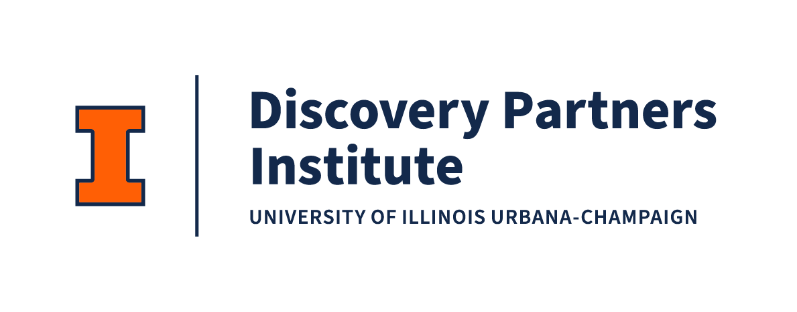

//

### DPI Precollege Programs — Empowering Illinois' Tech Future

Welcome to the **Discover Computing Program** — a 5-week journey into modern computing for high school students (Grades 9-10).  
This program introduces you to web development, data science, APIs, machine learning, and AI through hands-on projects that build real skills and a portfolio you can share.

---

## 🌟 About This Program

The **Pritzker Tech Talent Labs (PTTL)** at the **Discovery Partners Institute (DPI)** are dedicated to cultivating a diverse and skilled tech workforce across Illinois. The Discover Computing program is designed for early high school students who want to explore technology careers and build foundational computing skills.

**What You'll Gain:**
- 🚀 **Real Projects** — Build 5 live web applications for your portfolio
- 💻 **Modern Skills** — Learn tools used by professional developers
- 🤝 **Collaboration** — Practice pair programming and teamwork
- 🎯 **Career Exploration** — Connect coding to real-world tech careers
- 📚 **Portfolio** — Showcase your work to colleges and employers

---

## 📚 Curriculum Overview

This 5-week program takes you from your first webpage to building AI-powered applications. Each week builds on the previous concepts, creating a complete learning journey.

| Week | Theme | Skills & Technologies | Project |
|------|-------|---------------------|---------|
| 🚀 **Week 1** | HTML + CSS + GitHub | HTML, Tailwind CSS, GitHub Pages | Personal Portfolio Page |
| 📊 **Week 2** | Data Storytelling | Python, pandas, matplotlib, Google Colab | Data Analysis with Superheroes & Animals |
| 🕸️ **Week 3** | APIs & Dynamic Data | JavaScript, Axios, AlpineJS, REST APIs | Interactive API Explorer |
| 🤖 **Week 4** | Machine Learning | Teachable Machine, TensorFlow.js, Image Classification | Custom AI Models |
| 💬 **Week 5** | AI Career Mentor | React, Gemini API, Prompt Engineering | Personalized AI Chatbot |

---

## 🗺️ Weekly Lessons

### 🚀 Week 1 — HTML + CSS (Tailwind) + GitHub

**Build and publish your first web page: a Profile Card that grows into a Profile Page.**

- Learn HTML structure and Tailwind CSS styling
- Deploy to GitHub Pages
- Create your portfolio foundation

**Repository:** [DC_Fall-Week-1-HTML-CSS](https://github.com/The-Pritzker-Tech-Talent-Labs/DC_Fall-Week-1-HTML-CSS)

---

### 📊 Week 2 — Data Storytelling with Python

**Explore how data can tell stories about fictional heroes and real animals.**

- Clean and analyze datasets with pandas
- Create visualizations with matplotlib
- Work in Google Colab notebooks
- Tell data-driven stories

**Repository:** [DC_Fall-Week-2-Data-Analysis](https://github.com/The-Pritzker-Tech-Talent-Labs/DC_Fall-Week-2-Data-Analysis)

---

### 🕸️ Week 3 — Software Engineering w/ APIs & Dynamic Data

**Build dynamic web applications that connect to real-world data.**

- Make API calls with JavaScript and Axios
- Handle asynchronous operations
- Create responsive user interfaces
- Work with live data from the internet

**Repository:** [DC_Fall-Week-3-APIs-Dynamic-Data](https://github.com/The-Pritzker-Tech-Talent-Labs/DC_Fall-Week-3-APIs-Dynamic-Data)

---

### 🤖 Week 4 — Machine Learning with Teachable Machine

**Create your own AI models that recognize images in real-time using your webcam.**

- Train machine learning models without coding
- Integrate TensorFlow.js into web applications
- Build custom image classification models
- Deploy ML models to the web

**Repository:** [DC_Fall-Week-4-Machine-Learning](https://github.com/The-Pritzker-Tech-Talent-Labs/DC_Fall-Week-4-Machine-Learning)

---

### 💬 Week 5 — AI Career Mentor

**Build an interactive AI chatbot that helps students explore technology careers.**

- Integrate Google's Gemini API into React applications
- Design effective prompts for AI systems
- Deploy full-stack applications to Vercel
- Practice prompt engineering

**Repository:** [DC_Fall-Week-5-AI-Mentor](https://github.com/The-Pritzker-Tech-Talent-Labs/DC_Fall-Week-5-AI-Mentor)

---

## 🚀 Getting Started

### For Students

1. **Start with Week 1** — Each week builds on previous concepts
2. **Fork each repository** — Create your own copy to work on
3. **Use GitHub Codespaces** — No local setup required
4. **Follow the README** — Each week has detailed instructions
5. **Build your portfolio** — Add each project to your Week 1 portfolio page

### For Educators

- All lessons are self-contained with complete READMEs
- Projects use free tools (GitHub, Google Colab, Teachable Machine)
- No special software installation required
- Suitable for in-person or remote learning
- Includes reflection prompts and assessment checklists

---

## 🎯 Learning Outcomes

By completing this program, students will:

- ✅ **Build 5 live web applications** using modern technologies
- ✅ **Understand web development fundamentals** (HTML, CSS, JavaScript)
- ✅ **Work with data** using Python and visualization tools
- ✅ **Integrate APIs** to create dynamic, data-driven applications
- ✅ **Train machine learning models** and deploy them to the web
- ✅ **Build AI applications** using large language models
- ✅ **Deploy projects** to production platforms (GitHub Pages, Vercel)
- ✅ **Create a professional portfolio** showcasing their work
- ✅ **Explore tech careers** and understand pathways in computing

---

## 🛠️ Technologies You'll Learn

**Frontend Development**
- HTML5 & CSS3
- Tailwind CSS (utility-first CSS framework)
- JavaScript (ES6+)
- React (component-based UI library)
- AlpineJS (lightweight reactive framework)

**Backend & APIs**
- RESTful API integration
- Axios (HTTP client)
- Async/await patterns
- Environment variables

**Data Science**
- Python programming
- pandas (data manipulation)
- matplotlib (data visualization)
- Jupyter/Google Colab notebooks

**Machine Learning & AI**
- Teachable Machine (no-code ML)
- TensorFlow.js (browser-based ML)
- Google Gemini API (large language models)
- Prompt engineering

**DevOps & Deployment**
- Git & GitHub
- GitHub Pages
- Vercel (modern deployment platform)
- GitHub Codespaces (cloud development)

---

## 📖 Program Structure

Each week follows a consistent structure:

1. **Mini Project** — Guided introduction to core concepts
2. **Main Project** — Independent application of skills
3. **Deployment** — Publish your work live on the web
4. **Portfolio Integration** — Add to your growing portfolio
5. **Reflection** — Connect learning to real-world applications

---

## 🤝 Support & Resources

### For Students

- **Weekly READMEs** — Complete step-by-step instructions in each repository
- **Troubleshooting Sections** — Common issues and solutions
- **AI Assist Prompts** — Suggested prompts for getting help
- **Pair Programming Tips** — Best practices for collaboration

### For Educators

- **Curriculum Alignment** — Aligned with CSTA standards
- **Assessment Checklists** — Built-in submission criteria
- **Extension Activities** — Stretch goals for advanced students
- **Reflection Prompts** — Encourage metacognitive thinking

---

## 🌐 Related Programs

The Pritzker Tech Talent Labs offer programs for learners at all stages:

**K–12 Programs**
- **Digital Explorers (Grades 6–8)** — Foundational computing concepts
- **Discover Computing (Grades 9–10)** — This program
- **Digital Scholars (Grades 11–12)** — Advanced preparation for college and careers

**College Programs**
- **Digital Bridge** — Community college to tech careers
- **Computer Science Starter Academy** — Foundational CS education
- **Summer Tech Interns** — Practical experience opportunities

**Adult Programs**
- **Tech Talent Accelerator** — Career transition into tech roles

Learn more at: [https://dpi.uillinois.edu/tech-talent-development/](https://dpi.uillinois.edu/tech-talent-development/)

---

## 📝 Submission & Assessment

Each week includes:
- ✅ **Submission Checklist** — Verify all requirements are met
- 📊 **Project Deliverables** — Working applications deployed live
- 💬 **Reflection Responses** — Thoughtful answers to prompts
- 🔗 **Portfolio Links** — All projects accessible via portfolio page

---

## 🔗 Quick Links

**Program Resources**
- [DPI Tech Talent Development](https://dpi.uillinois.edu/tech-talent-development/)
- [Discovery Partners Institute](https://dpi.uillinois.edu/)
- [Pritzker Tech Talent Labs](https://dpi.uillinois.edu/tech-talent-development/)

**Weekly Repositories**
- [Week 1: HTML + CSS](https://github.com/The-Pritzker-Tech-Talent-Labs/DC_Fall-Week-1-HTML-CSS)
- [Week 2: Data Analysis](https://github.com/The-Pritzker-Tech-Talent-Labs/DC_Fall-Week-2-Data-Analysis)
- [Week 3: APIs & Dynamic Data](https://github.com/The-Pritzker-Tech-Talent-Labs/DC_Fall-Week-3-APIs-Dynamic-Data)
- [Week 4: Machine Learning](https://github.com/The-Pritzker-Tech-Talent-Labs/DC_Fall-Week-4-Machine-Learning)
- [Week 5: AI Career Mentor](https://github.com/The-Pritzker-Tech-Talent-Labs/DC_Fall-Week-5-AI-Mentor)

**Learning Tools**
- [GitHub](https://github.com/) — Code hosting and collaboration
- [Google Colab](https://colab.research.google.com/) — Python notebooks
- [Teachable Machine](https://teachablemachine.withgoogle.com/) — ML model training
- [Vercel](https://vercel.com/) — Modern web deployment

---

## 💡 Why This Program Matters

Technology careers are among the fastest-growing and highest-paying fields. However, many students don't have access to quality computing education or clear pathways into tech.

**This program addresses that gap by:**
- 🎯 Providing hands-on, project-based learning
- 🌍 Using free, accessible tools (no expensive software)
- 🤝 Encouraging collaboration and peer learning
- 🚀 Building real projects students can showcase
- 💼 Connecting skills to actual careers
- 🌈 Creating inclusive pathways into tech

---

## 🎓 Program Philosophy

**Learn by Building**
- Every concept is learned through creating something real
- Projects are immediately deployable and shareable
- Students see their work come to life on the web

**Progressive Complexity**
- Start simple (HTML/CSS) and build to advanced (AI/ML)
- Each week introduces new concepts while reinforcing previous ones
- Students gain confidence through incremental challenges

**Real-World Relevance**
- All technologies are used by professional developers
- Projects mirror real-world applications
- Career connections are explicit and meaningful

**Inclusive Design**
- No prior coding experience required
- Multiple learning styles accommodated
- Pair programming encourages collaboration
- Reflection prompts connect learning to personal goals

---

## 📧 Contact & Support

**For Program Information:**
- Visit: [https://dpi.uillinois.edu/tech-talent-development/](https://dpi.uillinois.edu/tech-talent-development/)
- Email: Contact information available on the DPI website

**For Technical Issues:**
- Check the Troubleshooting section in each weekly README
- Review GitHub Issues in the respective repositories
- Consult the Helpful References sections for documentation

---

## 📄 License & Usage

This curriculum is developed for educational use within the DPI Discover Computing Program.  
All weekly repositories include detailed READMEs with complete instructions for students and educators.

---

## 🙏 Acknowledgments

**Developed for the DPI Discover Computing Program**  
**Pritzker Tech Talent Labs**  
**Discovery Partners Institute, University of Illinois**

**Curriculum Development:**  
Aaron Douglas LLC

**Program Support:**  
The Pritzker Tech Talent Labs team and partner organizations

---

> "Behind every datapoint is a story — sometimes it's a superhero, sometimes it's a species fighting to survive. Behind every line of code is a possibility — sometimes it's a webpage, sometimes it's an AI that helps someone find their path."

**Welcome to your journey in computing. Let's build something amazing together! 🚀**

